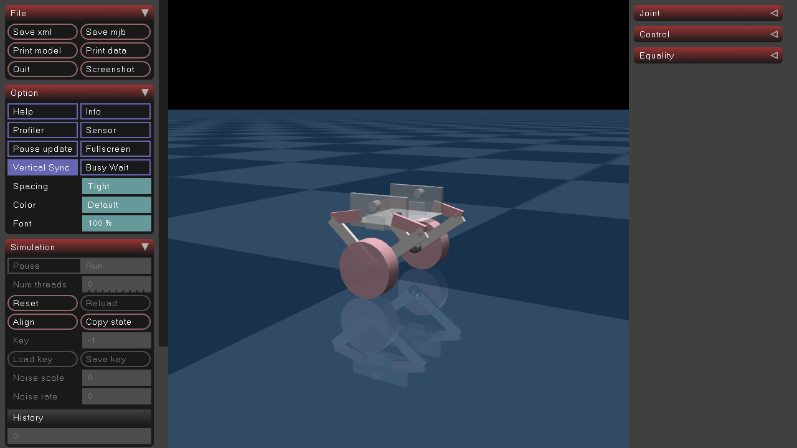

# 09 实战：MuJoCo 接入 ROS2

把前面学的串起来，做一件真事：**把队里 [Wheel_Leg](../../Wheel_Leg/README.md) 的 MuJoCo 轮足仿真，封装成一个 ROS2 节点**，对外发布 IMU / 关节状态，并接收速度指令。

对应代码：`ros2_ws/src/wheel_leg_bridge/`（已在本机验证可跑）。

## 1. 目标架构

原来的仿真是一个大 while 循环（`robot_control_main.py`），传感器和控制全揉在一起。我们要把它拆成：

```text
┌──────────────────────────┐
│  wheel_leg_bridge 节点    │
│                          │
│  MuJoCo 模型 + 仿真循环    │──发布──▶ /imu (sensor_msgs/Imu)
│                          │──发布──▶ /joint_states (sensor_msgs/JointState)
│                          │◀─订阅── /cmd_vel (geometry_msgs/Twist)
└──────────────────────────┘
```

- **发出去**：别的节点（决策/可视化）能订阅机器人状态。
- **收进来**：别的节点能发 `cmd_vel` 控制轮子。

这就是"把非 ROS 程序接入 ROS2"的标准套路：**在仿真循环外裹一层 ROS2 的话题/订阅**。

## 2. 数据从哪来

MuJoCo 模型 [robot.xml](../../Wheel_Leg/LQR_VMC/mjcf/robot.xml) 里已经定义好了传感器，原代码 [robot_info_update.py](../../Wheel_Leg/LQR_VMC/robot_mujoco_sensor_feedback/robot_info_update.py) 负责读它们。我们做的，是把这些原始数据**映射成标准 ROS 消息**：

| MuJoCo 传感器 | 内容 | ROS 消息 |
|---|---|---|
| `orientation` (framequat) | 姿态四元数 `[w,x,y,z]` | `Imu.orientation`（ROS 要 `[x,y,z,w]`，注意换序） |
| `angular_vel` (gyro) | 角速度 `[x,y,z]` | `Imu.angular_velocity` |
| `right1_pos/vel` … `leftwheel_pos/vel` | 6 个关节位置/速度 | `JointState.position/velocity` |

## 3. 节点代码逐段看

完整代码在 `wheel_leg_bridge/wheel_leg_bridge.py`。

### 加载模型 + 声明参数

```python
import mujoco
from ament_index_python.packages import get_package_share_directory

self.declare_parameter('robot_xml', '')
xml = self.get_parameter('robot_xml').value
if not xml:
    xml = os.path.join(
        get_package_share_directory('wheel_leg_bridge'),   # 找包安装目录
        'robots', 'robot.xml')                             # 模型文件

self.model = mujoco.MjModel.from_xml_path(xml)
self.data = mujoco.MjData(self.model)
self.dt = self.model.opt.timestep    # 0.002 s
```

- 模型文件 `robot.xml`/`obstacles.xml` 被复制进包并装到 `share/`，用 `get_package_share_directory` 定位，**不写死绝对路径**。
- 也可以 `--ros-args -p robot_xml:=/自定义路径/robot.xml` 覆盖。

### 发布者 + 订阅者

```python
from sensor_msgs.msg import Imu, JointState
from geometry_msgs.msg import Twist

self.imu_pub = self.create_publisher(Imu, 'imu', 10)
self.joint_pub = self.create_publisher(JointState, 'joint_states', 10)
self.create_subscription(Twist, 'cmd_vel', self.cmd_vel_cb, 10)
```

### 控制循环（定时器 + 步进仿真）

```python
self.timer = self.create_timer(0.02, self.step)   # 50 Hz

def step(self):
    # 执行器顺序：0-3 腿关节，4=右轮，5=左轮
    self.data.ctrl[0:4] = 0.0
    self.data.ctrl[4] = self.right_torque
    self.data.ctrl[5] = self.left_torque

    for _ in range(10):                            # 10 × 0.002 = 0.02 s
        mujoco.mj_step(self.model, self.data)

    self.publish_imu()
    self.publish_joints()
```

- MuJoCo 的 `dt=0.002`（500 Hz），ROS 定时器跑 50 Hz，所以每次回调**步进 10 次**。
- 订阅回调里只存目标值，真正下发在 `step()` 里做，保持节奏稳定。

### cmd_vel → 轮力矩（差速）

```python
def cmd_vel_cb(self, msg):
    k = 1.0
    self.left_torque  = k * (msg.linear.x - msg.angular.z * self.track / 2.0)
    self.right_torque = -k * (msg.linear.x + msg.angular.z * self.track / 2.0)
```

`linear.x` 驱动前进，`angular.z` 做差动转弯。模型左右轮转轴方向相反，所以右轮力矩要取负：纯前进时左右执行器力矩异号，但两轮向同一方向滚动。

### 发布 IMU（注意四元数换序）

```python
def publish_imu(self):
    msg = Imu()
    msg.header.stamp = self.get_clock().now().to_msg()
    msg.header.frame_id = 'imu'

    w, x, y, z = self.data.sensor('orientation').data   # MuJoCo: [w,x,y,z]
    msg.orientation.x = float(x)
    msg.orientation.y = float(y)
    msg.orientation.z = float(z)
    msg.orientation.w = float(w)                        # ROS: [x,y,z,w]

    gx, gy, gz = self.data.sensor('angular_vel').data
    msg.angular_velocity.x = float(gx)
    msg.angular_velocity.y = float(gy)
    msg.angular_velocity.z = float(gz)
    self.imu_pub.publish(msg)
```

## 4. 运行验证

依赖（MuJoCo）装在 conda 环境 `rm_ros2` 里，**构建和运行都要先激活它**（创建方法和完整依赖清单见[第 1 章](01_环境准备与工作区.md)第 4 节）：

```bash
conda activate rm_ros2
source /opt/ros/humble/setup.bash
cd ros2_ws
colcon build --symlink-install
source install/setup.bash

# 终端 A：启动桥接节点
ros2 run wheel_leg_bridge wheel_leg_bridge

# 终端 B：看话题
ros2 topic list | grep -E 'imu|joint_states|cmd_vel'
ros2 topic echo /imu --once          # 看姿态四元数
ros2 topic echo /joint_states --once # 看 6 个关节

# 终端 C：发速度指令（机器人轮子会转）
ros2 topic pub -r 10 /cmd_vel geometry_msgs/msg/Twist \
  "{linear: {x: 0.5}, angular: {z: 0.3}}"
```

> 说明：`wheel_leg_bridge` 只做了"数据通路"，没有接 LQR/VMC 平衡控制器，所以车体会倒——这是**故意的**。平衡控制正是下一节大作业要你做的事。

## 5. 大作业：把控制解算搬到 ROS2 里

### 5.1 题目

第 9 章前面的 `wheel_leg_bridge` 是"仿真 + 控制揉在一个节点里"——它自己把 `cmd_vel` 换算成轮力矩。本次作业要彻底拆开：

> **MuJoCo 只当仿真器和执行器出口（节点已提供，不许改）；LQR / VMC 等全部解算由你写在独立的控制器节点里；两者只用 ROS2 话题通信。**

### 5.2 架构契约

```text
┌──────────────────────────┐   /imu  /joint_states   ┌─────────────────────────┐
│  仿真节点 wheel_leg_sim   │ ──────────────────────▶ │   控制器节点（你写）      │
│  （已提供，学生不改）      │                         │  · 四元数 → 欧拉角       │
│  · mj_step，固定 dt=0.002 │                         │  · VMC 五连杆正运动学    │
│  · 读传感器 → 发话题       │     /actuator_cmd       │  · LQR 状态更新 + K 矩阵  │
│  · 订阅指令 → data.ctrl   │ ◀────────────────────── │  · VMC 力矩映射          │
│  · 不含任何控制律          │                         │  → 6 个执行器力矩        │
└──────────────────────────┘                         └─────────────────────────┘
```

仿真节点就是 `src/wheel_leg_sim/`，已在本机验证可跑。

### 5.3 接口（必须严格照此实现）

| 方向 | 话题 | 类型 | 内容 |
|---|---|---|---|
| 仿真→控制器 | `/imu` | `sensor_msgs/msg/Imu` | `orientation` 机体姿态四元数 (x,y,z,w)；`angular_velocity` 机体角速度 (rad/s) |
| 仿真→控制器 | `/joint_states` | `sensor_msgs/msg/JointState` | name 依次是 `right1,right2,left1,left2,rightwheel,leftwheel`；`position`(rad)、`velocity`(rad/s) |
| 控制器→仿真 | `/actuator_cmd` | `rm_msgs/msg/WheelLegCmd` | 6 个关节力矩 (N·m) |
| 外部→控制器 | `/cmd_vel` | `geometry_msgs/msg/Twist` | 目标速度（阶段 2/5 用），映射到 LQR 的 `v_set` |

`WheelLegCmd` 的字段顺序与 [robot.xml](../../Wheel_Leg/LQR_VMC/mjcf/robot.xml) 里 `<actuator>` 的定义一致，正好对应 MuJoCo 的 `data.ctrl[0..5]`：

```text
float64 right_phi1    # 右腿近端  joint_right_phi1   -> ctrl[0]  (限幅 ±6.0)
float64 right_phi4    # 右腿远端  joint_right_phi4   -> ctrl[1]  (限幅 ±6.0)
float64 left_phi1     # 左腿近端  joint_left_phi1    -> ctrl[2]  (限幅 ±6.0)
float64 left_phi4     # 左腿远端  joint_left_phi4    -> ctrl[3]  (限幅 ±6.0)
float64 right_wheel   # 右轮      right_wheel_torque -> ctrl[4]  (限幅 ±2.0)
float64 left_wheel    # 左轮      left_wheel_torque  -> ctrl[5]  (限幅 ±2.0)
```

### 5.4 硬性约束（本次的考点）

1. **控制器节点里不得出现 `mujoco`**；**仿真节点里不得出现任何控制律**（PID / LQR / VMC 一律不许）。
2. 两个节点必须能**各自独立 `ros2 run`** 启动，禁止进程内共享变量或全局状态。
3. **允许并鼓励**复用 [Wheel_Leg/LQR_VMC/](../../Wheel_Leg/LQR_VMC/) 下的 `vmc_cal.py`、`lqr_update.py`、`roll_leg_control.py`、`ground_detection.py`——把这几个文件复制进你的包，或封装成一个库包再 import。
4. **不允许**把 [robot_control_main.py](../../Wheel_Leg/LQR_VMC/robot_control_main.py) 的主循环整段搬过来——那样等于没拆分。

> 换句话说：**这次考的不是控制算法，而是"把控制回路拆成两个 ROS2 节点"这件事。** 算法直接抄现成的没问题，接口和架构必须自己搭对。

### 5.5 怎么跑

**先自己创建控制器包（只执行一次）**。先完成第 4 节的构建，然后在同一个 `ros2_ws/` 工作区执行；如果已经创建过这个包，不要重复创建：

```bash
conda activate rm_ros2
source /opt/ros/humble/setup.bash
# 当前目录应是 Tutorial/ros2_ws/，执行 ls 能看到 src/
ros2 pkg create wheel_leg_controller \
  --build-type ament_python \
  --node-name wheel_leg_controller \
  --destination-directory src \
  --dependencies rclpy sensor_msgs geometry_msgs rm_msgs
colcon build --symlink-install --packages-up-to wheel_leg_controller
source install/setup.bash
```

生成的入口文件是 `src/wheel_leg_controller/wheel_leg_controller/wheel_leg_controller.py`，`setup.py` 会自动注册同名可执行命令。**生成的程序只打印 `Hi from wheel_leg_controller.` 后退出，还不是常驻 ROS 节点**。先用下面的命令确认入口能找到，再参考第 3 章把它改成继承 `Node`、使用 `rclpy.spin()` 的节点，并实现第 5.3 节的话题接口和控制回调。

复用算法时，把文件放到内层 `wheel_leg_controller/` 中，与入口文件同级，并使用相对导入，例如 `from .vmc_cal import five_links_param`。不要导入原工程的 MuJoCo 传感器读取或整个主循环。

启动时开两个终端，**每个终端都先执行** `conda activate rm_ros2`、`source /opt/ros/humble/setup.bash`，进入同一个工作区并 `source install/setup.bash`，再分别运行：

```bash
# 终端 A：仿真节点
ros2 run wheel_leg_sim wheel_leg_sim
```

```bash
# 终端 B：你的控制器
ros2 run wheel_leg_controller wheel_leg_controller
```

必做任务只需仿真，不需要实体机器人、电控板或手柄。**仿真节点默认会打开 MuJoCo 查看器窗口**；收到控制器的有效指令后才开始推进，在控制器尚未实现发布力矩时模型不动是正常现象。镜头默认跟踪机体，常用参数：

| 参数 | 默认 | 说明 |
|---|---|---|
| `viewer` | true | 设 `false` 关闭 GUI；Linux 未设置 `DISPLAY` / `WAYLAND_DISPLAY` 时自动跳过查看器 |
| `cam_distance` | 1.2 | 镜头到机体的距离 (m) |
| `cam_azimuth` / `cam_elevation` | 120 / -12 | 方位角、俯仰角 (度) |
| `viewer_fps` | 60 | 渲染帧率 |

```bash
# 无界面运行（远程 SSH、或配合自动化脚本）
ros2 run wheel_leg_sim wheel_leg_sim --ros-args -p viewer:=false

# 想换个角度看
ros2 run wheel_leg_sim wheel_leg_sim --ros-args -p cam_distance:=2.0 -p cam_elevation:=-25
```

若显示变量已设置但显示服务不可用（如失效的 SSH 显示转发），请显式设置 `viewer:=false`；GLFW 的后台初始化错误不一定能被 Python 异常捕获。

> 开着 GUI 时仿真是**慢动作**运行（渲染要占时间），属正常现象——控制周期仍是"一条指令 = 一个 dt"，与墙钟速度无关，所以平衡结果不受影响。



检查数据流是否通：

```bash
ros2 topic hz /joint_states      # 有稳定频率 → 仿真在步进
ros2 topic hz /actuator_cmd      # 有频率     → 你的控制器在发指令
```

> ⚠️ **别和 `wheel_leg_bridge` 同时跑。** 第 9 章教学版的 `wheel_leg_bridge` 用的是**同名话题**
> （`/imu`、`/joint_states`）。一个话题上挂两个发布者时，你的控制器会收到**两个仿真器交错的状态**，
> 必然失稳——而且看起来像是"我代码没错但它就是摔"。
>
> 所以动手前先确认只有它一个在跑：
>
> ```bash
> ros2 node list        # 应只看到 /wheel_leg_sim（外加你自己的控制器）
> ```
>
> 如果确实需要两个一起跑，给其中一个加命名空间隔离：
> `ros2 run wheel_leg_sim wheel_leg_sim --ros-args -r __ns:=/sim`（此时话题变成 `/sim/imu` 等）。

### 5.6 三个必须知道的工程细节

**① 仿真节点是"指令驱动"的：一条指令 = 一个 dt。**

`wheel_leg_sim` 不按墙钟自己步进，而是**每收到一条 `/actuator_cmd` 才步进一个 `dt`（0.002 s）**，然后回发一次状态。这样你控制器里的 `dt` 恒等于 0.002，与 `lqr_update.py` 里那套 K 矩阵（按 dt=0.002 离散整定）严格一致。

> 代价是仿真推进速度取决于你的发布速度（可能快于或慢于实时）。这不影响正确性，你也不需要去"调仿真频率"。

**② 不用怕启动顺序：仿真节点有"心跳"。**

超过 0.5 s 没收到指令，仿真节点会**补发一次当前状态**，所以你的控制器晚启动、中途重启都能自动接上，不会双方互相空等。

**③ 传输延迟真实存在，但实测扛得住。**

拆成两个进程后，每个控制周期比原来内联循环多 0.2–2 ms 的 DDS 传输延迟。作业的参考解在本机实测：**10 s 站桩，后半程 pitch 稳定在 0.24°**。所以只要按接口实现，平衡是能达到的。

### 5.7 分阶段任务与验收

建议按顺序做，每阶段都能独立验收：

| 阶段 | 任务 | 验收标准 |
|---|---|---|
| 1 打通链路 | 控制器先只发固定值/正弦，把三条话题跑起来 | `/joint_states`、`/actuator_cmd` 都有稳定频率，轮子有响应 |
| 2 轮速控制 | 只用 `/joint_states` 的轮速做 PI，让它按 `/cmd_vel` 前后走（先不管平衡） | 发 `linear.x=0.5` 时轮速跟随，误差 < 20% |
| 3 VMC 接入 | 引入 `vmc_cal.py`，用腿关节角算 `L_0`/`theta`，输出腿力矩 + 腿长 PID | `L_0` 稳定在目标值 ±5 mm |
| 4 **LQR 平衡（必做）** | 引入 `lqr_update.py`，用 IMU 的 pitch/gyro + 轮里程计做状态更新，输出轮力矩 | **原地平衡 ≥ 5 s**，机体 pitch 偏差 < 10° |
| 5 加分项 | 平衡状态下跟踪 `/cmd_vel`；加速度限制；抗扰（推一把）；**接手柄遥控**（见 5.10） | 以 0.3 m/s 前进 3 m 不摔 |

### 5.8 提交物

1. 一个新包 `src/wheel_leg_controller/`（`ament_python`），`colcon build` 通过；
2. 该包的 `README.md`：说明你的控制结构、K/参数来源，以及**实测的平衡时长与 pitch 曲线**；
3. 一段 10–20 s 录屏，或 `ros2 bag record /imu /joint_states /actuator_cmd` 的 bag 文件。

把录屏 / bag 的可访问链接写进控制包的 `README.md`，不要把大型录像或 bag 直接塞进 Git。确认 `origin` 是**自己的 Fork**，再在仓库根目录提交：

```bash
cd "$(git rev-parse --show-toplevel)"
git remote -v
git status
git add 02-ros2-wheelleg/Tutorial/ros2_ws/src/wheel_leg_controller
git commit -m "Complete ROS2 wheel-leg controller assignment"
git push origin main
```

提交自己的仓库链接（如 `https://github.com/USERNAME/training`），并注明控制包位置和录屏 / bag 链接。不要直接推送队伍公共仓库，也不要修改冻结的 `wheel_leg_sim`。

### 5.9 参考资料

| 文件 | 内容 |
|---|---|
| [robot_control_main.py](../../Wheel_Leg/LQR_VMC/robot_control_main.py) | 原版单进程控制主循环（移植蓝本） |
| [robot_info_update.py](../../Wheel_Leg/LQR_VMC/robot_mujoco_sensor_feedback/robot_info_update.py) | 四元数→欧拉角、6 关节读取的算法 |
| `Wheel_Leg/LQR_VMC/vmc_cal.py` | 五连杆正运动学 + VMC 力矩映射 |
| `Wheel_Leg/LQR_VMC/lqr_update.py` | LQR 状态更新 + K 矩阵多项式 |

> 一个容易踩的移植细节：`vmc_cal.py` 里 `last_L_0`/`last_phi_0`/`last_alpha` 是在赋值的**下一行**就被更新的，所以 `d_L_0`、`d_phi_0`、`d_alpha` **恒为 0**。这是原版的既有行为，照原样移植即可——"顺手修好"反而可能不稳。
>
> **另一个更隐蔽、后果更严重的坑：`x_b_set` 不能每步都写。** 原版是这么写的：
>
> ```python
> if not (current_v == 0.0 and teleop.target_v == 0):   # 站桩时【不更新】
>     lqr_left.x_b_set  = (common_motor_pos * wheel_radius)
>     lqr_right.x_b_set = (common_motor_pos * wheel_radius)
> ```
>
> 也就是说**只在运动时**让 `x_b_set` 跟着当前位移走；站桩时冻结它。这样 `x_b - x_b_set` 才表示"停下来之后漂了多远"，`K[4]`/`K[5]` 两个位置项才能构成位置环。
>
> 如果你图省事写成每步都 `x_b_set = 当前位移`，那么 `x_b - x_b_set ≡ 0`，**位置环直接失效**。现象很有迷惑性：车能稳稳站住、pitch 也正常，但会以**恒定速度一直往前滑走**，完全不收敛——看着就像"一辆会站立的小车"，而不是轮腿平衡控制器。
>
> 实测对比（站桩 13 s）：出错时位置从 −83 rad 线性涨到 −223 rad（**滑走 8.4 m**，轮速恒定 1.75 rad/s）；修正后位置**锁死在 −1.46 rad ± 0.01**。

### 5.10 可选：接手柄遥控

如果想让机器人能手柄遥控（阶段 5 的加分项），**推荐走 ROS2 标准的 `/joy` 话题**，而不是在控制器里直接读硬件（`pygame` / `evdev`）：

```text
/dev/input/js0 ──▶ joy_node ──/joy (sensor_msgs/Joy)──▶ 你的控制器 ──▶ 摇杆映射成 v/w
```

- `joy_node`（`ros-humble-joy`）负责读设备并发布 `/joy`；
- 你的控制器只订阅 `/joy`，把摇杆映射成 LQR 的 `v_set`、按键映射成目标腿长；
- 好处：**硬件与算法解耦**、换手柄只改参数、**没有实体手柄也能用合成消息测试**。

先确认设备与数据是否正常：

```bash
sudo apt install -y ros-humble-joy     # 如果还没装
ros2 run joy joy_enumerate_devices     # 列出设备（应看到你的手柄）
ros2 run joy joy_node                  # 另一个终端
ros2 topic echo /joy --once            # 看 axes / buttons 布局
```

参考解沿用了队里 `remote/xbox_controller.py` 的习惯（Xbox 360 布局）：

| 操作 | 轴/键 | 效果 |
|---|---|---|
| 左摇杆 上下 | `axes[1]` | 前进/后退，`v = -axis × 0.6` m/s |
| 右摇杆 左右 | `axes[3]` | 左转/右转，`w = -axis × 2.0` rad/s |
| RB / LB | `buttons[5]` / `[4]` | 目标腿长 ±0.005 m（限位 0.10–0.14） |

死区取 **0.1**；按键做**边沿触发**（按一次改一次，长按不狂涨）。

> ⚠️ **两个容易翻车的地方**
>
> 1. **必须给线速度加爬坡限幅**。摇杆从 0 猛推到满杆，目标速度会瞬间跳 0.6 m/s，倒立摆上一下就顶翻。用 `util/climb_traj.py` 的 `VelocityRampFilter`（原版就是 0.8 / 1.4 m/s²）。
> 2. **手柄和 `/cmd_vel` 要有优先级约定**。建议手柄优先，并在超过 `joy_timeout`（如 0.5 s）收不到 `/joy` 时自动退回 `/cmd_vel`——这样上课能用手柄、自动化测试还能用话题。

## 6. 本节要点（串起全部章节）

| 用到的知识 | 对应章节 |
|---|---|
| conda 环境与依赖管理 | 01 |
| 建包、colcon、entry_points | 01、03 |
| 发布者/订阅者 | 03 |
| 标准消息 `sensor_msgs` / `geometry_msgs` | 03 |
| 自定义消息 `WheelLegCmd` | 04 |
| 参数 `robot_xml` | 05 |
| 定时器 / 回调驱动的控制循环 | 03、09 |
| 把非 ROS 程序裹成节点 | 09 |
| **把控制解算拆进独立节点（大作业）** | 09 |

到这里，你已经走完"从零 → 概念 → 工具 → 自写节点 → 消息/服务/TF → 串口 → 实战接入仿真"的完整链路。剩下的就是大作业和真实项目了。

---

回到 [README](README.md) 查看完整目录。
