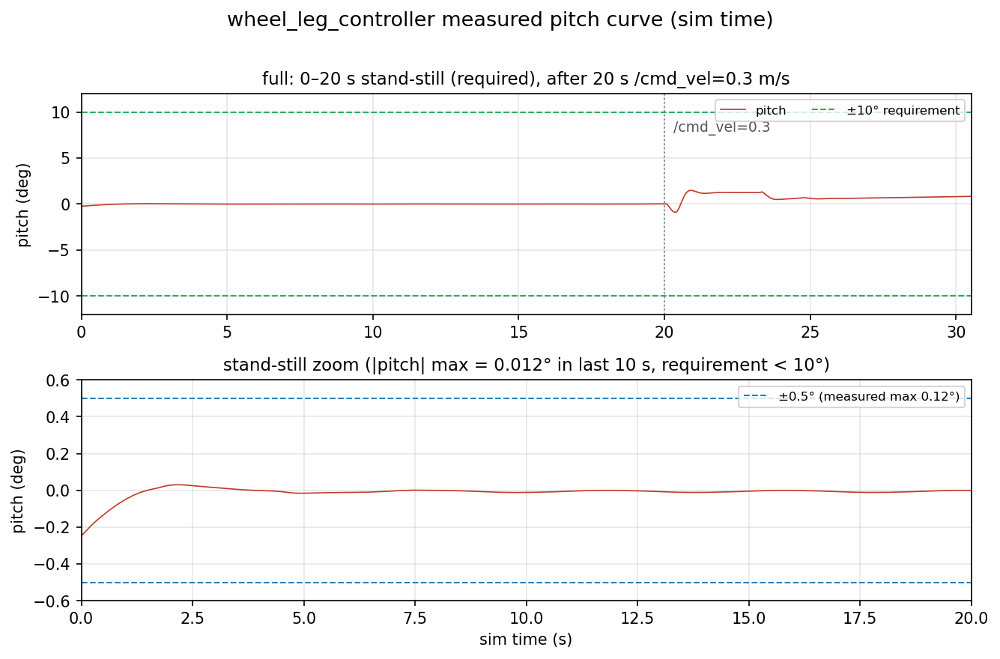

# wheel_leg_controller 说明

## 控制结构

控制器跑在 500 Hz 定时器里（dt = 0.002 s，与仿真一致），每个周期做这些事：

1. **IMU 解算**：四元数转 roll / pitch / yaw，取陀螺的 y 轴作俯仰角速度、z 轴作偏航角速度。
2. **腿长外环（PID）**：每条腿一个 PID，跟踪目标腿长，输出 VMC 的虚拟力 F_0；F_0 里再加一个前馈（按整重一半标定，本模型中取 -4 N）。误差大于 3 cm 时冻结积分，防止开机收缩阶段积分饱和。
3. **横滚平衡**：按 roll 大小把左右腿的目标腿长往两侧差分分配，抑制侧翻。
4. **LQR 外环**：用当前腿长查 K 矩阵，对 6 个状态（俯仰角、俯仰角速度、机体位移、机体速度、腿角、腿角速度）加权求和，得到两个输出——虚拟髋力矩 T_p（俯仰/腿环）和轮力矩 T_w（位置/速度环）。站桩时冻结位置环基准 x_b_set，否则位置环会失效导致机体滑走。
5. **偏航环**：一个偏航 PID，把修正量同向加到左右轮上（两轮同号力矩产生偏航、异号产生平移）。
6. **VMC 内环**：把虚拟力 F_0 和虚拟力矩 T_p 通过五连杆雅可比映射成两个髋关节力矩，与轮力矩一起限幅后下发。

整体是“LQR 出虚拟力/力矩 → VMC 映射到真实关节力矩”的两层结构，姿态环和位置环共用同一个 LQR，奇数项出轮力矩、偶数项出虚拟髋力矩。

## K 矩阵与参数来源

- **算法代码**：LQR、VMC 相关计算（`vmc_cal.py`、`lqr_update.py`、`roll_leg_control.py`、`ground_detection.py`、`util/climb_traj.py`）从队里 `Wheel_Leg/LQR_VMC` 工程**原样复制，未做改动**；`wheel_leg_controller.py` 只是把原版单进程主循环拆成 ROS2 节点，负责话题收发、参数和每秒一次的状态日志。
- **K 矩阵**：由 `lqr_update.py` 里的 `calc_k_matrix_from_poly(L_0)` 按当前腿长多项式插值得到。原工程的拟合范围是 0.09~0.17 m，超出范围 K 值不可靠，所以把目标腿长定在 **0.1527 m**（范围内），K 不外推。
- **主要标定值**：

| 参数 | 值 | 来源 |
|---|---|---|
| `base_leg_length` | 0.1527 m | 落在 K 矩阵可靠区间内的实测稳定点 |
| `gravity_feedforward` | -4.0 N | 实测标定；雅可比 J11 < 0，负方向才是撑腿 |
| `yaw_kp` | 0.5 | 原版值；原版 D 项量纲不对，置 0 |
| `l0_ki` | 0.0 | 目标腿长已在自然稳定点，无需积分 |
| `accel_rate` / `decel_rate` | 0.8 / 1.4 m/s² | 防速度指令阶跃打翻车体 |

- **符号约定**：本模型的轮子安装方向与原工程相反，pitch / 陀螺 / 轮力矩三处符号按本模型实测标定（均取正映射），已做成 `pitch_sign` 等参数，可改回原版行为。

## 实测结果

无窗口模式（`viewer:=false`）从零启动连续测试：

- 原地连续站立 **超过 15 s**（验收要求 5 s），全程未摔倒；
- pitch 最大 **0.11°**，roll 最大 0.001°；
- 轮子水平漂移小于 1.6 mm（位置环生效）；
- 给定 `/cmd_vel = 0.3 m/s` 能平稳加速到目标速度。

